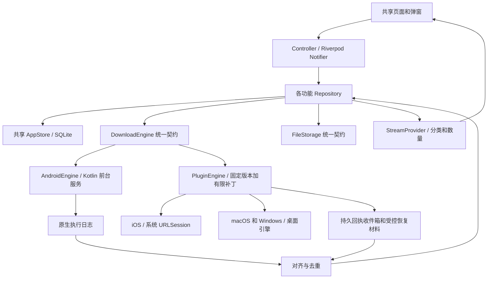
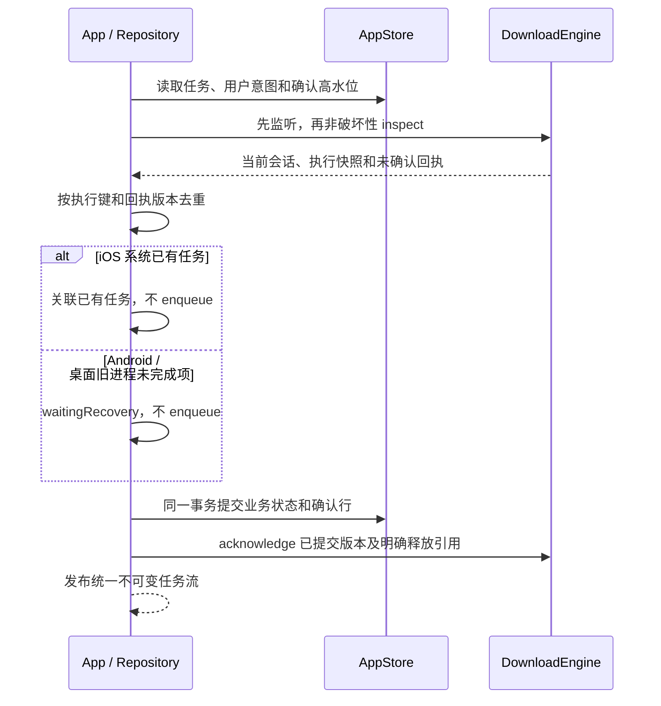
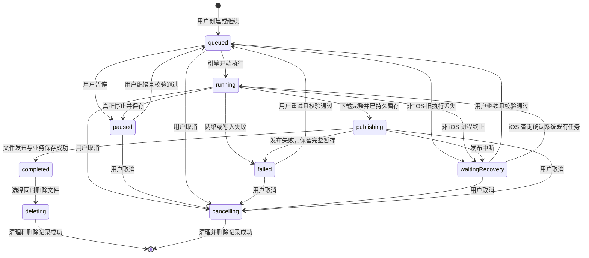

# 设计文档

## 概述

实现 Android、macOS、Windows 可用的下载管理器，并按已确认的 iOS 系统后台规则争取同步提供 iOS 版本。共同功能包括 HTTP/HTTPS 下载、暂停继续、任务恢复、文件管理、可复用下载配置、主题和默认目录。

依据：[需求文档](requirements.md)、[需求评审](review.md)、[Flutter 架构规范](../../../.trellis/spec/frontend/architecture.md)。截图仅作为界面与交互参考，不扩展代理、分享、认证资源、视频解析、搜索、批量管理等首期范围。

**状态：用户已批准进入实施；领域契约与 AppStore v1 已实现并通过独立检查，其他业务、下载引擎及插件补丁尚未实现。** 本稿替换原 Android 单平台方案。已落地范围及真实签名见[持久化契约](../../../.trellis/spec/frontend/persistence.md)；其余为后续实施契约，不代表原生构建、故障注入或真机验证通过。

### 已确认的生命周期差异

| 平台 | 切后台或最小化 | 进程终止或重新打开 |
| --- | --- | --- |
| Android | 系统允许时由前台下载服务继续 | 只恢复记录，未完成任务等待用户继续；不自动重排 |
| macOS / Windows | 应用进程存活时继续；休眠或系统限制可能中断 | 退出/终止后不保持下载；重新打开只恢复记录，等待用户继续 |
| iOS | 系统后台 URLSession 管理已提交任务 | 系统终止 App 后允许既有任务继续；重新打开只关联和同步，不重新提交失败或取消任务 |

iOS 用户主动在多任务界面强制退出会触发系统取消后台传输；再次打开后恢复记录并等待用户操作。设备重启后的 iOS 状态以系统查询为准，不能因本地记录仍为 running 就再次 enqueue。系统继续既有任务不等于应用主动重试失败任务。

### 当前代码与改动范围

- `lib/main.dart` 只有 `MyApp`、`MyHomePage`、`_MyHomePageState`；保留 Flutter 入口和平台工程，替换计数器首页。
- `test/widget_test.dart` 仍是计数器测试，界面子任务后续替换；已新增领域/DTO 与真实 SQLite 测试，`pubspec.yaml` 精确引入 sqlite3 3.5.2、path_provider 2.1.6。
- 四个平台工程均已存在，不能将“工程存在”当成下载能力已经支持。
- Android 的 `MainActivity.kt` 仍是 FlutterActivity 壳；主 manifest 没有业务网络/服务配置，release 仍使用 debug 签名。
- `ios/Runner/Info.plist` 是基础配置，需要核对后台会话交付、明文 HTTP 策略、签名及目录授权。
- macOS 的 DebugProfile/Release entitlements 已启用 sandbox，但没有业务客户端联网和下载目录授权；不能只验证 debug。
- `windows/CMakeLists.txt` 保留现有 Flutter 原生资产打包方式，后续核验 SQLite 和插件二进制是否进入 release 包。
- 不手写 GeneratedPluginRegistrant、generated_plugins 等生成文件；允许 Flutter 工具随真实依赖解析刷新生成产物。本子任务仅自动新增 Windows FFI 列表中的 jni 登记，未改原生权限、服务或构建策略。

## 架构

### 共同业务层与平台执行层

采用 Feature-first + MVVM 职责划分 + Repository/Service，Riverpod 管理状态和依赖。业务模型、分类、配置、主题、错误及文件安全规则共享；平台差异集中在 DownloadEngine 与 FileStorage。



| 组件 | 职责与边界 |
| --- | --- |
| View | 展示、输入、确认、无障碍；不直接调用插件、SQL 或系统 API |
| Controller / Notifier | 承担 ViewModel，暴露操作与处理中/失败反馈；不复制任务列表，不再叠加同职责 ViewModel |
| DownloadRepository | 唯一业务任务流，协调持久化、执行、发布与恢复；调用方不感知具体引擎 |
| SavedDownloadRepository | 只管理可复用配置；发起下载时调用 DownloadRepository，不访问另一个 Controller |
| SettingsRepository | 主题、默认目录和必要访问授权；局部输入状态仍可留在 Widget |
| AppStore | 四个平台共同的业务数据库入口，保存任务、配置和设置；不承担后台执行 |
| DownloadEngine | 真实执行、暂停确认、执行回执和恢复材料；不能把请求接受当作操作已完成 |
| FileStorage | 持久目录选择、目标新建、发布、删除和系统打开；不将 URI/bookmark 当普通路径 |

只有执行边界需要一个最小引擎契约以选择平台实现；不预建 BaseRepository、所有类的 Interface/Impl 配对或只有转发作用的 UseCase。复杂复用规则出现后再提取 UseCase。

### 执行实现的最小选择

- **iOS、macOS、Windows 复用 PluginEngine**，基于 `background_downloader` 9.5.9 的固定发布源码维护有限补丁。该版本原生回执先取后删、未知总长缺少字节事件、桌面续传可静默重下，不能把未经修改的发布包视作满足契约的实现。
- **Android 使用 AndroidEngine**，通过小范围平台通道接入可控前台服务。原因是严格要求进程终止后不得自动传输，不能仅凭插件 Dart 初始化关闭重调度就假定 WorkManager 原生路径也满足。
- 两个适配器共享 ExecutionKey、EngineTask、EngineReceipt 和错误约定；Android 不是整个应用的主架构，也不拥有其他平台的业务数据库。
- 所有平台先下载到应用持久暂存，再发布到固化的目标目录。不使用不能暂停/恢复的 UriDownloadTask 直接写入用户目录，以免为了目录支持破坏暂停能力。
- 补丁仅覆盖执行边界的持久读取/确认、恢复材料生命周期、累计字节事件和桌面恢复写入前校验，复用原下载实现。原生回执交付必须在原生层修正，不能仅增加 Dart 外层包装。iOS 系统私有 resume data 的安全行为仍是实体设备验收门槛。
- 插件子任务将固定源码和补丁纳入 `third_party/background_downloader/`，保留上游许可证、发布归档校验值及补丁差异，使用显式 path 依赖并提交 lockfile。暂不升级 SDK、不另建完整跨平台 HTTP 引擎；当前基础子任务尚未引入下载插件或该目录。

### 依赖与系统基线

本地环境已核对为 Flutter 3.44.8 / Dart 3.12.2，Flutter 当前 Android 默认 compileSdk/targetSdk 为 36。sqlite3 与 path_provider 已完成当前工程依赖解析；其他依赖仍为候选，完整业务依赖树及四平台构建尚未验证。

| 依赖 | 候选版本 | 用途 |
| --- | --- | --- |
| flutter_riverpod | 3.4.3 | 依赖组装、Notifier、StreamProvider；首期不要求代码生成 |
| background_downloader | 9.5.9 + 本仓库有限补丁（待实现） | iOS 和桌面下载适配；固定来源，Android 不向此插件提交任务 |
| sqlite3 | 3.5.2（已精确锁定） | 四个平台共享 AppStore；当前 macOS 主机真实 SQLite 测试通过，其他平台原生资产待验证 |
| path_provider | 2.1.6（已精确锁定） | 应用持久目录及平台下载目录定位；真实平台通道及授权待验证 |
| file_selector | 1.1.0 | 桌面系统目录选择；不假定它自动解决移动端持久授权或 macOS bookmark |

background_downloader 9.6.x 要求更高 SDK，本稿不以升级 SDK 为前置条件。9.5.9 原版仅是补丁基线，不能在 pubspec 中直接锁原版后声称契约已满足；实施时记录补丁源码提交。sqlite3 原候选 3.8.0 的实际解析因 hooks → record_use 要求 meta ^1.19.0，与当前 Flutter 固定 meta 1.18.0 冲突，已改为精确 3.5.2；不使用 dependency_overrides，不升级 SDK。Riverpod 等仍需实际解析和四平台 release 构建验证。

建议基线：Android 10/API 29+（简化公共下载目录）、iOS 14+（9.5.9 podspec 下限）、macOS 10.15+、Windows 10/11 64 位。它们是本稿待审核的支持基线，不是已完成兼容性认证；最终以 Flutter、传递依赖及设备验证后的共同下限为准。

### 目录与界面

```text
lib/
  main.dart
  app/                              # MyApp、主题、依赖组装
  features/
    downloads/
      presentation/                 # 页面、DownloadsController、弹窗
      domain/                       # 不可变模型、输入、失败类型
      data/                         # Repository、Engine 与具体适配
    saved_downloads/                # 界面仍称“缓存”
    settings/
  shared/
    data/                           # AppStore
    platform/                       # FileStorage 及实际共享的平台能力
android/app/src/main/kotlin/com/example/downloader/
  MainActivity.kt                   # 通道与系统结果
  downloader/                       # Service、执行日志、文件发布
third_party/background_downloader/    # 实施时引入固定上游源码及有限补丁
```

- 下载和设置是两个主入口；下载页包含下载中/已完成/缓存及数量。failed、paused、waitingRecovery、publishing 仍归下载中，只有完成发布的任务归已完成。
- 新建/编辑弹窗复用字段和校验，缓存保存不启动；创建下载才提交任务。
- 窄窗口采用紧凑导航，宽窗口调整列表空间；不新增搜索、排序或批量入口。保留中文、系统字体缩放、屏幕阅读器语义和桌面键盘焦点。
- 长名称可截断并查看详情；弹窗可滚动、避让软键盘；未知总长采用不确定进度，不显示虚构百分比和剩余时间。
- 删除默认仅删除记录，删除文件需明确选择；重新下载保留原文件。读取失败显示错误和重试，不当作空态。

桌面最小化保持应用运行；本稿建议关闭窗口视为退出请求，有活动任务时先确认停止并退出，正常退出前暂停并保存。macOS 的退出菜单也走同一协调流程；不增加托盘、守护进程或开机自启。强杀不保证收到退出回调，恢复依赖持久回执。

## 组件与接口

### 1. Scope / Trigger

跨越四个平台、数据库、后台执行和文件系统，必须明确命令确认、状态来源、持久化边界和部分失败。DownloadEngine、FileStorage 的接口及 DTO 已定义，具体适配和 Repository/Controller 仍待实现；AppStore 已有的事务入口见[持久化契约](../../../.trellis/spec/frontend/persistence.md)。

### 2. Signatures

```dart
// DownloadRepository
Stream<List<DownloadTask>> watchTasks();
Future<DownloadTask> create(CreateDownload input);
Future<void> pause(String taskId);
Future<void> resume(String taskId, {bool restartFromZero = false});
Future<void> cancel(String taskId);
Future<void> deleteCompleted(String taskId, {required bool deleteFile});
Future<DownloadTask> redownload(String taskId, String requestId);
Future<void> open(String taskId);

// DownloadEngine：公共边界，不泄漏插件 Task 或 PlatformException
Stream<EngineEvent> get events;
Future<EngineSnapshot> inspect();
Future<void> enqueue(EngineCommand command, EngineTask input);
Future<EngineReceipt> pause(EngineCommand command);
Future<void> resume(EngineCommand command);
Future<EngineReceipt> cancel(EngineCommand command);
Future<void> acknowledge(ReceiptAck ack);

// FileStorage
Future<DirectoryLocation?> pickDirectory();
Future<FileLocation> publish(PublishOperation operation);
Future<PublishRecovery> recoverPublication(PublishOperation operation);
Future<void> deleteOwned(FileLocation file);
Future<void> open(FileLocation file);

// SavedDownloadRepository
Stream<List<SavedDownload>> watchSavedDownloads();
Future<SavedDownload> save(SavedDownloadInput input);
Future<void> delete(String savedDownloadId);
Future<DownloadTask> start(String savedDownloadId, String requestId);

// SettingsRepository
Stream<AppSettings> watchSettings();
Future<void> setTheme(AppTheme theme);
Future<void> setDefaultDirectory(DirectoryLocation directory);
```

上述签名按所属组件分别列出，不作为同一 Dart 文件的顶层声明。DownloadsController 保留 `Future<void> pause(String taskId)`，只处理界面操作和反馈。AppStore 提供事务化查询/保存，状态变化由 Repository 形成统一任务流。

### 3. Contracts

#### 输入、命令与确认

- CreateDownload：requestId、url、fileName?、directory?。requestId 对同一次提交稳定且唯一；数据库去重，相同 requestId 不同输入拒绝，不同提交同一 URL 可创建新任务。
- URL 去除首尾空白，必须为 host 非空的 http/https；首期拒绝用户名/密码认证输入。用户文件名不能含路径穿越、分隔符和控制字符，并经平台合法性校验。
- directory 为空时，创建事务读取当时全局默认值并固化到任务。可复用配置中的空目录仍表示未来发起时读取最新默认值，不能在保存配置时提前固化。
- 创建顺序：事务保存任务和确定的 engineId/generation → 提交引擎。提交失败保留可识别失败记录；进程在两步之间终止时不自动补提交。
- create/resume 成功表示已保存并接受执行，不表示下载完成。pause 必须等实际传输停止、恢复材料和暂停回执持久保存，再由 Repository 提交业务状态和确认记录后成功返回。
- 同任务操作串行；已暂停再次暂停幂等，不可暂停/继续/删除的状态拒绝操作。Repository 校验时固定完整执行键和 expectedReceiptVersion，保存稳定 commandId，再发命令；适配器不得在发送或超时重试时重新查询并替换执行身份。页面不提前修改最终状态。
- 同 commandId 的重复请求只返回原结果；相同 commandId 不同载荷拒绝。启动请求结果不明时先 inspect，不自动另造命令或重提下载。旧会话、旧代次或不匹配的期望版本返回 stateConflict；restartFromZero 只在用户确认后为 true，使用新代次且保留已有完成文件。
- pickDirectory 返回 null 代表取消选择，旧值不变；save/config/delete 不操作由该配置创建的任务。

#### 执行回执与持久化所有权

AppStore 保存业务事实：用户输入、固化目录、用户操作意图、配置、设置及已对齐的任务快照。引擎日志保存执行事实、待确认回执、恢复材料和发布操作。业务数据库的写入方仍只有 Repository，页面不能订阅两套任务列表。

ExecutionKey 为不可变的 `{taskId, engineId, generation}`。EngineCommand 为 `{commandId, key, ownerSessionId, expectedReceiptVersion}`；首次提交的期望版本为 0，后续操作使用校验时捕获的版本。EngineTask 包含相同 key、url、requestedFileName?、固定目录和持久暂存定位；command 与 input 的 key 必须相等。

EngineReceipt 是完整执行快照，包含 key、receiptVersion、state、downloadedBytes、totalBytes?、resumeSupport、resumeRef?、stagingLocation?、publishOperation?、publishedLocation? 和 error?。receiptVersion 是同执行键下持久递增的正整数，不能因重启归零。resumeRef 只是不透明稳定引用，材料属于引擎，不渲染或写入普通日志。

EngineSnapshot 返回当前 ownerSessionId、当前会话事件序号及活动快照和待确认回执；即使没有任务也必须返回会话。inspect 是可重放读取，不删除记录、不启动传输。ReceiptAck 为 `{key, receiptVersion, releaseResumeRefs}`，默认不释放任何恢复材料。

#### 回执交付与回收协议

1. Android 原生日志、iOS 补丁原生收件箱、桌面补丁执行日志均先提交回执及其材料引用，再通知 Dart；状态/暂停/终态立即持久化。iOS 无 Dart 时也遵守该顺序。临时文件先保护到已登记的持久位置，再交付完成回执。
2. PluginEngine 的初始化读取改为非破坏性 read/inspect；禁止原版 pop 后清除再写 Dart 库的路径，不能一边保留新收件箱、一边让旧路径先删除同一恢复材料。插件状态缓存可以复用，但不是交付保证。
3. Repository 按执行键和 receiptVersion 去重，在同一 AppStore 事务保存业务快照及 engine_receipt_acks 高水位，再调用 acknowledge。重复交付不会重复发布、导入任务或恢复传输；版本较旧只确认已经提交的结果。
4. AppStore 写入失败不确认，下一次 inspect 重放；确认失败保留业务提交和待确认行，下次重发同一确认，不回滚真实状态或重提下载。取消/删除事务移除任务时仍保留确认行，避免丢失最后一次确认。
5. acknowledge 可幂等回收指定版本及更旧的回执，不能删除较新版本、活动快照或暂停/失败仍引用的恢复材料。releaseResumeRefs 必须在业务已持久决定取消、确认从零重下或完成发布后明确列出，并经引擎核对执行归属；普通暂停/失败确认总是空列表。
6. 补丁禁止 `.failed` 等终态自动清理仍被引用的恢复材料；`autoCleanDatabase:false` 只关闭插件清库策略，不能代替上述确认协议。进度可合并为最新检查点，暂停、终态与发布意图不可仅留在异步事件队列。

- AppStore 写入后才 enqueue；engineId 预先保存，同一执行键和 commandId 幂等。结果丢失通过 inspect 查找，不自动造新任务。
- 旧代次回调不能复活已取消、已删除或重下的任务；无业务记录的回执不自动导入、不自动传输，资源归属不明时保留诊断和清理意图，不猜测删除。
- cancelling/deleting 用户意图优先于迟到完成事件；按已提交意图处理回执和清理，再确认，不把取消项重新显示成功。
- 引擎已暂停但业务保存或确认失败时，如实显示已停止及同步错误，操作报告 persistenceFailure，不伪造运行或全面成功。
- 数据库与文件系统不是原子事务；发布操作必须在创建目标前持久登记，按后文平台恢复契约核对，不能仅持有创建后的句柄。

#### 启动与订阅



初次订阅先缓冲事件再查询快照，在 Repository 协调队列中合并；会话变化、事件序号缺失或顺序无法判断时再次 inspect。执行回执版本负责持久去重，会话内事件序号只负责发现漏事件，两者不能混用。watchTasks 先给一致快照；读取失败发错误，不发伪空列表。

iOS/桌面补丁初始化先建立持久收件箱并注册监听，替换破坏性 pop，再使用 `start(doRescheduleKilledTasks: false, markDownloadedComplete: false, autoCleanDatabase: false)`，任务重试次数为 0。参数本身不修复丢回执、失败清理或静默重下；须按补丁路径验证没有隐式 enqueue。Android 不向该插件提交下载。

UI 进度刷新最多每 200ms 一次；引擎进度检查点最多每秒一次。状态、暂停材料、发布阶段与业务确认立即提交；单调字节事件可合并，不能因总长未知停止发送。挂起后不伪造速度，回前台重新同步；恢复数据不得只存 cache 目录。

#### Android 通道

仅 AndroidEngine 使用 MethodChannel `downloader/android_engine` 与 EventChannel `downloader/android_engine/events`；命令为 inspect、enqueue、pause、resume、cancel、acknowledge。不能将整套 Repository API 改成 Android 协议。

所有载荷包含 protocolVersion=1。`inspect` 请求只需该字段；响应为 `{protocolVersion, ownerSessionId, sequence, receipts}`，空列表也返回原生生成的当前会话，不触发传输、不移除回执。Activity 重连取当前快照，不采用持久记录中的旧会话。

enqueue/pause/resume/cancel 携带 `{protocolVersion, commandId, taskId, engineId, generation, ownerSessionId, expectedReceiptVersion}`；enqueue 另含 EngineTask 请求字段。原生先校验会话、执行键、期望版本及命令幂等记录，再执行副作用。拒绝旧会话/代次/期望版本时返回 `stateConflict` 及 reason=`staleSession`/`staleExecution`/`staleReceipt`，不重绑当前执行。

acknowledge 携带 `{protocolVersion, taskId, engineId, generation, receiptVersion, releaseResumeRefs}`，只能确认已存在版本和归属匹配的引用；重复确认幂等，超前版本或跨执行释放返回 stateConflict。确认不启动网络，也不因收到确认自动删除活动数据。

StandardMessageCodec 只用基本类型；未知版本、缺字段或类型错误返回 protocolMismatch，非法状态返回 stateConflict。原生再次校验 URL、目录及命令 key 与任务 key 一致。事件带当前会话和单调 sequence，receiptVersion 跨重启保留；断连/换会话时重新 inspect。

## 数据模型

### 业务字段

| 模型 | 字段与约束 |
| --- | --- |
| DownloadTask | id、requestId、engineId、generation、originalUrl、effectiveUrl?、requestedFileName?、displayName、directory、status、downloadedBytes、totalBytes?、fileLocation?、lastError?、createdAt、updatedAt；另含 stagingRef?、targetRef?、engineReceipt?、pendingCommand?、publishOperation? |
| SavedDownload | id、url、fileName?、directory?、createdAt、updatedAt；新建表单预分配稳定 id，重复保存同表单不生成多条 |
| AppSettings | theme=system/light/dark、defaultDirectory；默认跟随系统 |
| DirectoryLocation | version=1、platform、kind、locator?、subdirectory?、displayName；kind 为 systemDownloads/appDocuments/userSelected |
| FileLocation | version=1、platform、kind=path/contentUri/bookmark、locator、identity?；路径/URI 不是归属证明，identity 由平台提供并在执行日志登记 |
| DownloadFailure | code、中文 message、taskId?、结构化 details?；用于业务判断的错误码稳定 |
| ExecutionKey / EngineCommand | taskId/engineId/generation，以及 commandId、当前 ownerSessionId、expectedReceiptVersion；校验后固定，不在发送时改绑 |
| EngineReceipt / EngineSnapshot | 完整执行回执及持久 receiptVersion；快照额外返回当前会话、会话 sequence 和回执集合 |
| ReceiptAck | key、receiptVersion、releaseResumeRefs；只确认已提交版本，暂停/失败不释放材料 |
| PublishOperation | operationId、key、sourceRef、sourceLength、directory、temporaryName、candidateName、phase=prepared/creating/copying/finalizing/published、targetRef?、identity?、error?；引擎日志持久保存，AppStore 镜像 |
| PublishRecovery | disposition=notCreated/staged/published/needsPermission/uncertain、ownedLocation?；核对结果，不触发新建、改名或删除 |

所有模型不可变；字节数为非负 64 位整数，未知 totalBytes 为 null，不能用 0 或 -1 代替。EngineEvent 即使不知道总长也提供累计 downloadedBytes；它与恢复偏移分开，实际恢复以引擎已提交检查点和验证器为准。速度与剩余时间是派生值，不作为恢复依据。桌面路径使用系统 API 和 Uri.file 编码，不能手写 file:// 拼接 Windows 路径。

### 共享 SQLite v1

AppStore 通过 sqlite3 在各平台的 application-support 持久目录创建 `downloader.db`，不放用户下载目录。短事务串行执行，SQL 参数绑定；长文件操作不在数据库事务或 UI 线程中执行。

```sql
CREATE TABLE download_tasks (
  id TEXT PRIMARY KEY NOT NULL,
  request_id TEXT NOT NULL UNIQUE,
  engine_id TEXT NOT NULL UNIQUE,
  generation INTEGER NOT NULL DEFAULT 0 CHECK (generation >= 0),
  original_url TEXT NOT NULL,
  effective_url TEXT,
  requested_file_name TEXT,
  display_name TEXT NOT NULL,
  directory_json TEXT NOT NULL,
  status TEXT NOT NULL CHECK (status IN (
    'queued', 'running', 'paused', 'waitingRecovery',
    'publishing', 'failed', 'completed', 'cancelling', 'deleting'
  )),
  downloaded_bytes INTEGER NOT NULL DEFAULT 0 CHECK (downloaded_bytes >= 0),
  total_bytes INTEGER CHECK (total_bytes IS NULL OR total_bytes >= 0),
  staging_ref TEXT,
  target_ref TEXT,
  engine_receipt_json TEXT,
  pending_command_json TEXT,
  publish_operation_json TEXT,
  last_error_json TEXT,
  created_at INTEGER NOT NULL,
  updated_at INTEGER NOT NULL
);
CREATE TABLE saved_downloads (
  id TEXT PRIMARY KEY NOT NULL,
  url TEXT NOT NULL,
  file_name TEXT,
  directory_json TEXT,
  created_at INTEGER NOT NULL,
  updated_at INTEGER NOT NULL
);
CREATE TABLE engine_receipt_acks (
  engine_id TEXT NOT NULL,
  generation INTEGER NOT NULL CHECK (generation >= 0),
  task_id TEXT NOT NULL,
  receipt_version INTEGER NOT NULL CHECK (receipt_version > 0),
  release_refs_json TEXT NOT NULL DEFAULT '[]',
  PRIMARY KEY (engine_id, generation)
  -- 不设置任务外键，取消/删除记录后仍需重发最后确认。
);
CREATE TABLE app_settings (
  id INTEGER PRIMARY KEY CHECK (id = 1),
  theme TEXT NOT NULL CHECK (theme IN ('system', 'light', 'dark')),
  default_directory_json TEXT NOT NULL
);
PRAGMA user_version = 1;
```

- 不建立配置到任务的级联删除关系；从配置创建任务时复制值，删除配置不影响任务或文件。
- 状态和主题用稳定字符串，时间用 UTC 毫秒；JSON 中的 platform/kind/version 需校验，未知结构返回数据版本错误，不能按空值覆盖原记录。
- pending_command_json 保存已校验命令身份；启动结果不明时只查询，不在启动恢复中自动重发。publish_operation_json 镜像引擎的发布操作和待处理错误；target_ref 非空不等于发布成功。实现中的 target_ref 为 version=1 JSON 信封，保存 `{version:1,targetRef:String?,fileLocation:FileLocation?}`；两者皆空则 SQL NULL，未知版本拒绝，不将任意不透明引用猜测为 JSON。
- engine_receipt_acks 的高水位与业务状态同事务更新，不能倒退；同执行同 receiptVersion 的完整回执和确认载荷必须相同，冲突返回 stateConflict。确认须核对现存任务的执行归属；保留的确认行也限制 engineId 被其他 taskId 重用或恢复旧代次。release_refs_json 仅包含已提交意图允许释放的本执行引用，任务移除后确认行仍保留，不设任务外键或级联删除。
- AppStore v1 已落库：user_version=0 时原子初建，version=1 校验必要表/列；未知版本直接拒绝并保留数据库，尚无已发版旧结构可升级。以后变更须逐版本迁移，失败不得删库重建；引擎日志独立版本、独立写入连接。内部 DTO 的嵌套 key JSON 与 Android 扁平通道载荷分别映射；ResumeSupport 枚举为 unknown/supported/unsupported，实际续传能力仍由引擎验证。
- Android 原生日志、iOS 补丁原生日志、桌面补丁日志持久保存执行键、命令幂等结果、回执版本/确认水位、请求、恢复材料引用及 PublishOperation。iOS 无 Dart 时也可写入；共享 AppStore 不是原生后台写入目标。

### 状态机



failed 默认不自动重试；iOS 系统仍在调度的既有任务按真实状态显示，不误标失败后再创建。cancelling/deleting 清理失败保留意图、回执确认行和资源定位。发布结果 uncertain 时保持 publishing 或带 publicationUncertain 的待恢复记录，不重新分配目标；本地发布重试不重新下载。仅删除完成记录不访问文件。

## 关键流程与平台适配

### 创建、进度与续传

1. URL 和文件名校验在共享业务层完成，原生/插件边界再次校验。保存固化目录、执行键和命令身份后才开始传输。
2. HTTP/HTTPS 支持重定向；Android 实现上限和循环检测。iOS 系统后台会话自行跟随重定向，不能假称每次均由 Dart 拦截。
3. 文件名优先用户指定、响应 Content-Disposition（filename* 优先）、最终 URL 路径，最后 `download_<taskId>`。服务端名称去除路径及控制字符；Windows 校验保留名称和非法字符，记录实际发布名称。
4. 传输流式写入、使用 64 位计数；已知总长验证实际完整长度，未知总长凭引擎正常 EOF 的持久终态进入发布，不能仅凭文件存在或比例到 100%。
5. 补丁新增独立字节载荷 `{key, downloadedBytes, totalBytes?, sampleMonotonicMs}`，不再以已知总长为发送前提。桌面以流实际写入计数加已验证起始偏移；iOS 使用下载 delegate 的累计字节参数并校准恢复偏移，不通过百分比反推。总长未知仍发送递增字节；总长、百分比、剩余时间为 null，禁止把未知比例映射成插件失败哨兵值。
6. pause 等待实际停止和持久回执；恢复材料存在时返回稳定 resumeRef，不因普通暂停/失败确认被清理。缺少可用材料则保留实际数据和 restartRequired 原因，后续继续先征得用户从零确认。
7. 桌面补丁在实际恢复 GET 的响应进入文件打开/删除/写入前校验 206、Content-Range 起始与长度、验证器及本地偏移。HTTP 200、416、资源变化、弱/缺失且无法安全确认的验证器或本地材料不匹配，均停止此次恢复并返回结构化 restartRequired，原部分文件保持不变；不得走原版 isResume=false 后 FileMode.write 或 deleteTempFile 的降级路径。HEAD 预检不能代替这一步。
8. Android 同样在响应写入前验证；iOS resume data 为系统私有材料，不自行拼偏移。须验证失效材料/资源变化时能否阻止未获确认的从零传输；若系统路径不能满足，不声称有限补丁已解决，停止扩大实现并报告该平台限制。只有用户确认 restartFromZero 后才能新建代次、清理本任务旧材料并从头请求。

速度由同一执行键下的单调时间和累计字节增量计算；首次样本、重新关联、恢复或计数基准变化时重置窗口，不跨进程比较时间戳。未知总长、无新样本或速度不稳定时剩余时间为 null；字节计数仍保留真实值，不能显示虚构零值。暂停不可续传资源也须实际停止，继续时等待从头下载确认。

### Android

AndroidEngine 的前台服务负责网络、执行日志及必要的目标发布，不依赖 Dart isolate；设置和缓存仍由共享 AppStore 管理。采用 dataSync 类型和 START_NOT_STICKY，不注册自动开始下载的 boot 接收器、不配置自动网络重试。

每个原生进程生成新 ownerSessionId，由 inspect 的空或非空快照返回；命令使用刚获取的会话并携带完整执行键和期望版本。拒绝旧会话/null/无效 Intent，不能只靠 START_NOT_STICKY。Activity 重连查询存活服务，不当作进程重启；旧进程任务只恢复记录，不自动传输。

前台服务受系统启动限制和时限影响。实现超时停止与检查点，不在 onTimeout 主线程等待长网络/文件操作；强杀时依赖已经持久化的数据。通知以状态和返回应用为主，不增加绕过用户恢复规则的后台继续按钮。

主 manifest 需配置 INTERNET、FOREGROUND_SERVICE、适用版本的 FOREGROUND_SERVICE_DATA_SYNC 和 POST_NOTIFICATIONS；服务 exported=false。普通 HTTP 是需求范围，要明确允许 cleartext，但不能绕过 HTTPS 证书校验。APK 安装交接按需核对 REQUEST_INSTALL_PACKAGES 和发布渠道限制。

### iOS

PluginEngine 使用 URLSession 后台传输；重建同一 session 标识只关联既有任务。补丁在原生回调中先保护完整临时文件并写持久收件箱，再交付 Dart 和完成系统回调；读取不先删除，收到 AppStore 的明确确认后才回收指定回执。不能等 Flutter UI 才保护文件，也不能让原版 pop 路径提前删除恢复材料。

主动强制退出、系统终止、挂起与设备重启分别验收。失败/取消任务不自动重新 enqueue；系统既有任务可继续等待网络和调度。配置同一会话、关闭应用侧自动重调度及失败重试，并测试同一业务任务只对应一个系统任务。

默认最终位置是应用 Documents 下的 Downloads 子目录。自选目录使用系统文档目录选择与持久 bookmark，访问前激活，不把当前会话 file URL 当永久授权。外部文件提供方在后台可能不可用：下载先落入持久暂存，必要时显示“已下载，待保存到目标目录”，回前台恢复授权后发布；发布前不标记 completed，也不静默改到其他目录。该平台差异需在本稿审核时明确。

核对 Info.plist 的 HTTP/ATS 策略和后台会话交付，保留 HTTPS 验证；不靠任意添加后台模式使 Dart 永久运行。系统下载调度不保证立即开始或无限后台运行。

### macOS / Windows

复用 9.5.9 的桌面实现及前述有限补丁，不能直接交付原版。任务属于当前应用进程，最小化不停止，正常退出先停止并保存，强杀后只恢复记录。初始化禁止重调度，失败不自动丢恢复材料，恢复 GET 不允许静默转从头写入；不引入守护进程或开机自启。

- macOS 保留 sandbox；DebugProfile 和 Release 均需客户端联网、下载目录读写和用户选择目录读写能力。自选目录跨重启访问需要持久 security-scoped bookmark，开始访问与结束访问配对，陈旧 bookmark 更新；选择器返回路径本身不等于永久授权。
- Windows 使用系统 Known Folder 对应的实际用户下载目录，允许系统重定向到其他磁盘，不拼接 `C:\\Users\\...`。测试中文/空格/长路径、被占用文件、权限拒绝及 release 二进制依赖。
- 默认下载目录必须对应用户可找到的系统下载目录，不把 macOS sandbox 私有替代路径静默当作公共下载目录。授权或系统定位失败时说明原因，不虚报成功。
- 系统文件打开使用安全的系统 API 或经核验的库，参数正确编码；不将 URL、文件名或路径插入 shell 命令字符串。

### 文件保存、不覆盖与清理

DirectoryLocation 的 systemDownloads 在 Android 映射到公共 `Download/Downloader/`，在 macOS/Windows 映射到系统当前用户下载目录下的 Downloader；iOS 默认使用 appDocuments/Downloads。目录按需创建；初始下载无需先选文件夹，但仍遵循系统必要权限流程。

用户目录：Android 保存 SAF tree URI 及持久授权；iOS 保存持久文档 bookmark；macOS 保存可重新授权的 bookmark；Windows 保存选择器返回的目录位置并每次验证可写。取消选择返回 null，设置保存失败保留原值；不提前释放仍被旧任务/配置使用的授权。

发布协议：

1. 完整下载保留在持久暂存。执行该次发布的日志写入方先提交 PublishOperation：随机 operationId、执行键、源文件/长度、固化目录、唯一暂存名称和 phase=prepared；写入失败不触碰目标。Android 在原生日志登记，iOS/桌面在补丁日志登记，AppStore 只镜像，不成为第二个发布者。
2. 进入 creating 阶段前再次提交，之后只在已授权的父目录以 operationId 对应的唯一暂存名称新建。保存实际句柄/身份后进入 copying；目标中的临时内容可能可见，但状态仍为 publishing。尚未保存句柄就终止时，恢复先精确核对该操作，不重新分配第二个目标，也不按普通文件名猜测归属。
3. 复制、关闭并校验完整性，保留私有完整暂存。最终名称冲突追加递增序号，已有文件保留；提交 finalizing、候选名称和已知身份后，以不会覆盖既有目标的操作最终发布。跨卷必须先复制到目标卷的已登记临时项；禁止先 exists 再用覆盖写或覆盖改名。
4. 最终句柄、实际名称和身份核对后提交 published 回执，AppStore 对齐为 completed，才清理私有暂存。进程在最终操作完成但回执未保存时，也必须先按该操作核对，不能凭目标存在就认定成功。
5. recoverPublication 只查询并返回 notCreated/staged/published/needsPermission/uncertain。确定 staged 时复用原目标继续本地发布；确定 published 时补写业务状态；只有已证明未创建且旧调用不可能继续时才允许同操作新建。uncertain 或授权丢失时保留操作、完整暂存和错误，等待核实/重新授权，不自动再创建或删除文件。

平台恢复边界：

| 目标 | 创建/最终发布前登记 | 创建成功但句柄未保存时 | 最终操作成功但回执未保存时 |
| --- | --- | --- | --- |
| 桌面本地目录、iOS 应用内目录 | 父目录身份、operationId 暂存名、源长度；最终阶段另记候选名和文件身份 | 精确查找已登记父目录中的操作临时项；核对操作归属并取得文件身份，身份不明不删除 | 比较临时/最终项与已保存文件身份；使用经验证的不覆盖发布能力，不能用普通覆盖式 rename |
| Android MediaStore | 本应用待发布条目的 RELATIVE_PATH、operationId 唯一 DISPLAY_NAME、预期大小与 pending 状态 | 在可访问的本应用条目中按完整操作标记精确查询；多项、名称被改写或归属不明返回 uncertain | 核对已保存条目 URI/行标识、实际名称与 IS_PENDING；最终更新结果不明先查询该条目，不重复 insert |
| Android SAF | 授权父文档、operationId 临时名及提供方能力 | 仅在提供方可精确查询并核验该操作归属时取回 URI；返回改名/自动编号导致无法证明归属则 uncertain | renameDocument 可能返回新文档 URI；不得假定旧 URI 总有效，必须能关联旧/新身份，否则保留 uncertain，不按同名文件认领 |
| Apple 用户选择/文件提供方目录 | security-scoped 父目录 bookmark、operationId 临时名及可验证身份 | 激活授权并协调查询已登记临时项；后台不可访问返回 needsPermission，名称或归属不明返回 uncertain | 解析已保存身份/bookmark 并协调核对；身份不可稳定关联时不猜测完成，不重复发布 |

唯一名称只是定位信息，不单独授权删除；平台适配还须核对创建记录、父目录和文件/提供方身份。创建或改名结果不明而无法核验时，使用 publicationUncertain 保留本次尝试，不宣称自动清理成功。能力已知不足的提供方在设置/发布前返回 directoryUnsupported 并说明原因，保留原设置或已固化目录及完整暂存；不能静默换目录。默认目录必须通过对应平台创建、改名和恢复验证，不能用该错误掩盖必需默认位置不可用。

取消先保存 cancelling、停止并等待写入退出，再恢复核对本任务发布操作，清理确定归属的部分文件/未完成目标。uncertain 项不猜测删除，返回 cleanupFailure 并保留记录、操作和处理指引；只有清理确实完成才移除任务并确认释放材料。删除完成文件同样先保存 deleting；文件不存在可清除记录，身份或授权不符则保留错误。

重新下载使用原链接和原任务固化目录创建新任务，原完成记录和文件保留；来自配置的下载则按配置当前值解析目录。全局默认目录改变不迁移任何现有任务。

文件打开交给平台：Android 以 content URI、MIME 和临时读取授权调用系统，APK 仅交安装流程；iOS 使用允许的系统预览/处理程序；桌面调用系统默认处理程序。无处理程序、文件不存在或权限不足提示原因，不自动执行安装、不调用分享面板作为兜底。

## 错误处理

### 4. Validation & Error Matrix

| 错误码 | 条件 | 必须行为 |
| --- | --- | --- |
| invalidInput / protocolMismatch | URL、名称、载荷、协议版本或枚举无效 | 拒绝命令，不创建任务或覆盖原设置 |
| notFound / stateConflict | 无任务、命令载荷冲突、旧会话/执行键/期望版本或超前确认 | 不重绑新执行、不产生副作用；reason 区分 staleSession/staleExecution/staleReceipt，查询真实状态 |
| networkUnavailable / timeout / httpFailure | 断网、超时、服务器拒绝 | 保留材料，失败确认不释放；iOS 既有系统任务按真实调度状态展示 |
| restartRequired | 恢复 GET 非安全 206、资源/偏移/验证器变化、材料失效 | 在打开或破坏原部分文件之前停止，不静默重下，等待确认 |
| directoryUnavailable / permissionDenied | 授权失效、目录不可写、外部提供方不可用 | 保留记录、发布操作和完整暂存；不静默换目录 |
| directoryUnsupported / publicationUncertain | 提供方不能安全恢复发布，或创建/改名结果无法核实 | 返回能力原因或待核实结果，不重复新建、覆盖或猜测删除；允许重新授权及核对后重试 |
| insufficientSpace / fileWriteFailure | 暂存/目标写入、关闭或完整性检查失败 | 不标完成，保留可追踪材料和发布操作 |
| backgroundRestricted | 系统禁止执行、超时或取消 | 转入待恢复/失败并说明，不许诺无限后台 |
| persistenceFailure | 业务提交、回执持久写入或确认失败 | 不删库、不确认未提交回执；确认失败保留待确认行并重放，不恢复传输 |
| cleanupFailure | 取消/删除/发布清理失败或归属无法确认 | 保留清理意图及定位，不虚报移除，不误删其他文件 |
| fileMissing / noHandler / installPermissionRequired | 文件不存在、无法打开或安装授权未完成 | 反馈原因，保留记录；不自行安装或删除其他数据 |

错误类型在适配边界映射，不通过匹配插件原始错误字符串决定业务。UI 反馈避免回调与命令返回重复弹出矛盾消息；诊断日志默认不记录完整 URL 查询参数、私有路径、bookmark 或授权 URI。

## 测试策略

### 5. Good/Base/Bad Cases

- Good：四平台完成已知/未知总长下载；未知总长仍有真实累计字节；安全续传保留原数据；iOS 只关联既有系统任务；重复回执只提交一次业务副作用。
- Base：空列表 inspect 也给当前会话；重复暂停/确认幂等；取消选择保留设置；删除不存在文件的完成记录不影响其他任务。
- Bad：取回回执后或创建目标后立即终止、业务提交后确认失败、失败时仍有恢复材料、GET 返回 200/错误 Range、旧命令迟到、提供方改名换 URI；不丢未确认回执、不截断原数据、不重复发布、不猜测归属。

### 6. Tests Required

| 测试层 | 断言点 |
| --- | --- |
| Dart 单元 | DTO 和完整执行键；未知总长字节非零且递增，比例/剩余时间为 null；恢复/换进程重置速度窗口；旧代次和旧版本去重 |
| Repository / 引擎契约 | 空快照握手；固定命令 key/版本；旧命令迟到不作用于新执行；重复 commandId 幂等；业务提交前不得确认，确认失败重放不重复副作用；暂停 Future 等实际停止和持久提交 |
| SQLite | v1 全部约束、重复 requestId、64 位偏移；回执确认高水位与业务状态同事务，回滚不提前确认；删除任务不级联确认行；迁移不丢数据 |
| Widget | 重下/删除确认、publicationUncertain 与清理失败反馈、字节进度未知值、处理中、中文语义、大字体、键盘和窗口 |
| HTTP 可控服务 | 无长度慢响应在完成前持续更新累计字节；恢复 GET 的 200/206/416、错误 Content-Range、强/弱/变化 ETag、本地材料损坏；拒绝时旧部分文件长度和散列不变，收到从头确认前新代次请求数为 0 |
| 回执故障注入 | 持久接收后 Dart 读取前、读取后 AppStore 提交前、提交后确认前分别终止；重开可重放且只对齐一次；零重试失败后 resumeRef 及材料仍在；较旧确认不删新材料 |
| 发布故障注入 | prepared/creating、创建后句柄提交前、copying、最终改名后 published 提交前逐点终止；核对操作后复用或报 uncertain，不新增第二个目标；同名外来文件不被认领/删除 |
| 平台文件安全 | 默认目录、自选目录跨重启授权、MediaStore pending 查询、SAF 改名换 URI、Apple 提供方不可用/身份变化；并发重名不覆盖，权限/磁盘/锁定失败可追踪 |

平台矩阵：

- Android：API 29、30、33、35、36，覆盖后台、通知拒绝、滑走 Activity、进程终止、设备重启、系统超时。除当前存活的服务外，终止后无用户操作时新网络请求必须为 0。
- iOS：至少最低支持版本和当前目标版本的实体设备；分别测试挂起、系统终止、用户强制退出、重启、锁屏、断网恢复。以系统任务 id/服务端请求记录验证不重复提交、不自动重排失败任务；验证完成临时文件及时持久化。
- macOS：最低支持版本及当前系统，测试 debug/release sandbox、下载目录位置、自选目录 bookmark 跨重启、窗口关闭与菜单退出；退出后不传输。
- Windows：Windows 10/11，在真实 Windows 环境构建运行；验证 Known Folder、中文和特殊路径、文件占用、退出/强杀和 DLL/原生资产随包交付。macOS 构建不能证明 Windows 可用。

初始工程样本为 100 条历史记录、两个活动任务及一个超过 4GiB 的可控大文件，检查 64 位偏移和流式内存占用，不承诺尚未实测的性能指标。实际并发控制先遵循引擎可验证能力，不新增用户并发设置。

当前已执行 flutter analyze（无问题）和 flutter test（48 项通过：27 契约、20 真实 SQLite、1 计数器）；仅证明领域与持久化基础，不代表真实下载已实现。后续分别执行各平台构建及原生/集成测试，平台验收不得用当前主机单元测试替代。

### 7. Wrong vs Correct

错误：所有平台都依赖 AndroidGateway；页面先改暂停状态；应用启动遍历未完成记录重新 enqueue，包括 iOS 已在系统里的任务。

```text
UI 提前显示 paused → 引擎仍在传输
重新打开 → 每条未完成任务 enqueue → 可能重复下载
```

正确：共享 Repository 调用平台引擎；实际停止和保存后确认；按平台对齐记录，iOS 只关联已存在任务。

```text
pause → 引擎停止确认 → 保存恢复材料与业务状态 → UI 更新
Android / 桌面重启 → waitingRecovery → 等用户继续
iOS 重新打开 → 查询系统任务 → 关联与同步 → 不重复提交
```

错误：原生 pop 删除后交 Dart；将 autoCleanDatabase=false 当作永久保留材料；用 taskId 重新查询代次发送旧命令；先创建用户目标再记日志。

正确：

```text
引擎持久回执 → 非破坏性读取 → AppStore 同事务保存状态和确认行 → 幂等确认
未知总长 → 独立累计字节事件 → 大小/速度真实，比例与剩余时间未知
恢复 GET 校验通过 → 才打开原部分文件追加；否则 restartRequired，保留原数据
校验捕获执行键和期望版本 → 固定命令 → 原生拒绝旧身份，不重绑
先登记发布操作 → 创建/核验身份 → 复制/不覆盖发布 → 核对结果 → completed
创建/改名结果不明 → uncertain → 保留材料和处理入口，不重复新建
```

## 需求覆盖

| 验收项 | 对应设计与验证 |
| --- | --- |
| 1.1、1.2、1.3、1.4、1.5、1.6 | 创建/HTTP、独立累计字节事件、未知总长展示、分类数量及协议范围 |
| 2.1、2.2、2.3、2.4、2.5 | 真实停止、确认后保留材料、安全 GET 与确认重下、取消清理及身份核对 |
| 3.1、3.2、3.3、3.4、3.5 | 生命周期、持久收件箱/业务确认、会话快照、iOS 例外与手动恢复 |
| 4.1、4.2、4.3、4.4、4.5 | 平台打开、Android APK、无处理程序、新任务重下、无分享 |
| 5.1、5.2、5.3、5.4、5.5、5.6 | 配置独立表、保存不执行、新任务、编辑取消、动态默认目录、无级联 |
| 6.1、6.2、6.3、6.4、6.5、6.6、6.7、6.8 | 固化目录、命名、创建前发布操作、平台归属恢复、不覆盖及默认位置 |
| 7.1、7.2、7.3、7.4 | 主题订阅与保存、持久目录授权、权限引导、无代理设置 |
| 8.1、8.2、8.3、8.4、8.5 | 错误矩阵、手动重试、安全续传、权限与空间反馈、发布后才完成 |
| 9.1、9.2、9.3、9.4、9.5 | 空态、长名称、大字体/键盘/窗口、真实结果反馈、中文与无障碍 |

## 实施顺序与验证门槛

1. 先实现并验证最小执行补丁与文件契约：持久收件箱的读取/确认、失败材料保留、未知总长累计字节、桌面恢复 GET 写入前拒绝、空快照会话握手和平台发布操作恢复。不以原版插件行为或文档修订代替验证。
2. 四平台最小原型固定补丁来源、完成依赖解析和 release 构建；在默认目录及至少一个可支持的用户目录执行上述故障注入，并验证 iOS 安全续传及 Android 停止/禁止自动重启。未通过前不批量铺页面，不把不明提供方当已支持。
3. 固化 EngineTask/Command/Receipt/Snapshot/Ack、PublishOperation 与 AppStore v1；先完成恢复对齐、清理和确认重放，再实现共享页面、任务操作、配置、设置及系统打开。
4. 对照所有验收项跑平台矩阵并更新最终接口。iOS 若无法满足关键门槛，明确报告并由用户决定取舍；不能静默减功能或宣称有限补丁必然解决系统限制。

用户已批准以本设计进入任务实施；最低系统版本、Android 独立执行适配，以及 iOS 外部目录不可用时先暂存再发布均作为实施验证基线，仍须通过平台验收。若实际能力迫使改变需求或安全契约，再向用户报告并决定取舍。iOS 系统终止后允许系统继续既有任务的规则已批准。

### 本轮独立审查的修订对应

| 审查项 | 设计修订 | 实施验收 |
| --- | --- | --- |
| P1 回执与材料丢失 | 非破坏性收件箱、业务事务确认高水位、显式材料释放 | 三处交付中断、确认失败重放、失败材料仍可用 |
| P1 未知总长进度 | 独立累计字节事件，不由比例反推 | 无 Content-Length 的慢响应在完成前字节增长 |
| P1 创建目标后失去归属 | 创建前 PublishOperation、各平台核对、uncertain 阻止重复副作用 | 创建/最终操作后的中断及提供方身份变化 |
| P2 Android 执行身份 | 空快照握手、固定 key/commandId/期望版本、拒绝旧身份 | 首次空列表、Activity 重连、旧会话/代次/版本请求 |
| P2 桌面静默重下 | 明确要求补丁在实际 GET 写入前拒绝不安全恢复 | 返回 200/坏 Range/变化 ETag 时原部分文件不变 |

以上只表示设计契约已修订；补丁、故障注入及真机结论仍未完成。

## 调研依据

- 固定发布包：`https://pub.dev/api/archives/background_downloader-9.5.9.tar.gz`；SHA-256=`ae55e127f87397b372578fc9474568b879fa78326103c342e00160558d08e527`，已核对作者元数据。复核 BDPlugin.swift 的 popLocalStorage、base_downloader.dart 的恢复材料清理、桌面 isolate 的未知总长/恢复写入以及 TaskFunctions.swift 的进度条件；这些是补丁需求的证据，不是补丁已通过的证明。
- 候选包元数据：`https://pub.dev/api/packages/flutter_riverpod`、`https://pub.dev/api/packages/sqlite3`、`https://pub.dev/api/packages/path_provider`、`https://pub.dev/api/packages/file_selector`。
- Apple 后台会话：`https://developer.apple.com/documentation/foundation/urlsessionconfiguration/background(withidentifier:)`。
- Apple 后台下载：`https://developer.apple.com/documentation/foundation/downloading-files-in-the-background`。
- Apple sandbox 及持久 bookmark：`https://developer.apple.com/documentation/security/accessing-files-from-the-macos-app-sandbox`。
- Android 前台服务：`https://developer.android.com/develop/background-work/services/fgs/timeout`；Service 的 START_NOT_STICKY 语义与待处理 Intent 需一起验证。
- Android 目录：`https://developer.android.com/training/data-storage/shared/documents-files`、`https://developer.android.com/training/data-storage/shared/media`。
- Android SAF 改名返回 URI 的契约：`https://developer.android.com/reference/android/provider/DocumentsContract#renameDocument(android.content.ContentResolver,android.net.Uri,java.lang.String)`；不能假定旧文档标识总有效。
- Windows 不覆盖移动能力：`https://learn.microsoft.com/en-us/windows/win32/api/winbase/nf-winbase-movefileexw`；实现不得启用 MOVEFILE_REPLACE_EXISTING，仍需验证目标卷和文件身份恢复。

调研已确认系统机制及部分固定版本源码；基础子任务已完成 sqlite3/path_provider 依赖解析、当前 macOS 主机真实 SQLite 测试与独立检查。原生 release 构建、Windows 实机及移动端真机实验尚未进行，不能把声明支持平台或当前主机测试等同于满足本应用全部安全和恢复契约。
